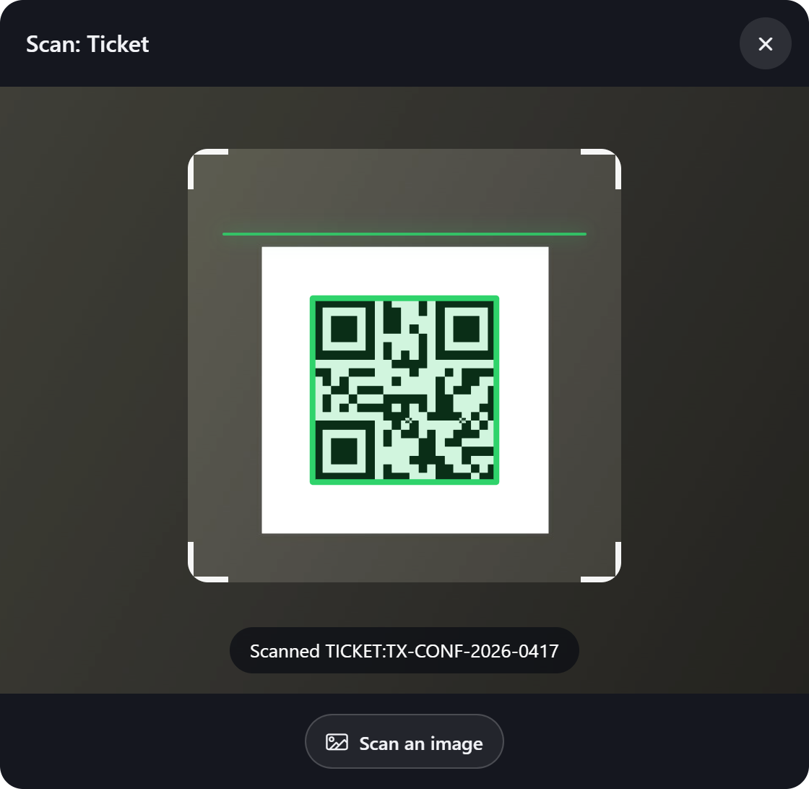

# Barcode Scanner for Oracle APEX

A text field with a Scan button that reads QR codes and barcodes with the device camera.



| | |
|---|---|
| **Type** | Item plug-in |
| **Internal name** | `COM.TECHREVX.BARCODE_SCANNER` |
| **Version** | 1.0 |
| **Requires** | Oracle APEX 26.2 or later |
| **License** | MIT |

## What it does

Barcode Scanner turns any phone, tablet or laptop with a camera into a scanner for your APEX forms: tickets at the door, products in a stock count, asset tags, parcels, serial numbers. It is a normal text field with a Scan button, so users can still type the code.

- **Thirteen formats**: QR Code, EAN-13, EAN-8, UPC-A, UPC-E, Code 128, Code 39, Code 93, Codabar, ITF, Data Matrix, PDF417 and Aztec.
- **Every browser**: codes are read with ZXing in WebAssembly, so it works in Chrome, Safari, Firefox and Edge, on phones and computers, also where the browser has no barcode reader of its own. Nothing is loaded from other sites.
- **A scanner people understand**: a viewfinder, the code outlined when it is found, a beep and a vibration, the flashlight and switching between front and back cameras.
- **Keep scanning**: for stock counts and batches, the scanner stays open and every code fires an event; the same code is only read again after two seconds.
- **Scan an image**: read a code from a photo or a file, for computers without a camera or codes received by email.
- **Clear messages**: when the camera is blocked, missing, busy or the page is not secure, users are told what to do.

## At a glance

- **Formats**: QR Code, EAN-13, EAN-8, UPC-A, UPC-E, Code 128, Code 39, Code 93, Codabar, ITF, Data Matrix, PDF417 and Aztec, read with ZXing in WebAssembly, so it works in every current browser, not only those with a built-in barcode reader.
- **Scanner**: live camera view with a viewfinder, the code outlined when found, beep and vibration, flashlight, switch camera, and Scan an Image for photos or devices without a camera. Close after one code, or Keep Scanning for stock counts.
- **Field**: users can still type or paste the code, and all usual item settings apply (Value Required, placeholder, read only). The camera needs HTTPS (or localhost) and the user's permission.
- **JavaScript**: techrevx.barcodeScanner.get( "P1_CODE" ).open() and close(). Events: Change, Barcode Scanner - Code Scanned (this.data = { value, format }).

## Installation

1. Download `plugin/item_type_plugin_com_techrevx_barcode_scanner.sql` from the [latest release](https://github.com/aamirkhanz/apex-plugin-barcode-scanner/releases/latest) (or from this repository).
2. In App Builder, open your application and go to **Shared Components > Plug-ins**.
3. Choose **Import**, select the file and finish the wizard.
4. Set a page item's type to **Barcode Scanner [Plug-in]** and choose the formats you expect.

Everything the plug-in needs is inside the SQL file, including barcode-detector and zxing-wasm; it loads nothing from other sites.

## Example

```sql
-- Dynamic Action: Barcode Scanner - Code Scanned on P20_SKU
-- Action: Execute Server-side Code, Items to Submit P20_SKU, Items to Return P20_PRODUCT, P20_STOCK
select product_name, stock_qty
  into :P20_PRODUCT, :P20_STOCK
  from products
 where ean = :P20_SKU;
```

The camera only works on secure pages (HTTPS, or localhost while developing), and the browser asks the user once for permission.

## Attributes

### Scanning

| Attribute | Type | Default | Description |
|---|---|---|---|
| **Formats** (required) | Checkboxes | `qr:ean13:ean8:upcA:upcE:code128:code39:dataMatrix` | The kinds of codes the scanner looks for. Fewer formats scan faster and avoid reading the wrong code. Values: `qr` QR Code, `ean13` EAN-13, `ean8` EAN-8, `upcA` UPC-A, `upcE` UPC-E, `code128` Code 128, `code39` Code 39, `code93` Code 93, `codabar` Codabar, `itf` ITF, `dataMatrix` Data Matrix, `pdf417` PDF417, `aztec` Aztec. |
| **After a Scan** (required) | Select list | `close` | Close: the scanner closes and the item gets the value. Keep Scanning: the scanner stays open for the next code, for example to count stock; every code sets the item and fires Barcode Scanner - Code Scanned. The same code is read again only after two seconds. Values: `close` Close, `continue` Keep Scanning. |
| **Feedback** | Checkboxes | `beep:vibrate` | Beep: a short tone when a code is read. Vibrate: a short vibration on phones that support it. Values: `beep` Beep, `vibrate` Vibrate. |

### Scanner

| Attribute | Type | Default | Description |
|---|---|---|---|
| **Camera** (required) | Select list | `back` | The camera to start with on phones and tablets. Users can switch when Switch Camera is on. Values: `back` Back, `front` Front. |
| **Features** | Checkboxes | `image:torch:switch` | Scan an Image: read a code from a photo or a file, also where there is no camera. Flashlight: turns on the phone's light where the browser allows it. Switch Camera: shown when there is more than one camera. Values: `image` Scan an Image, `torch` Flashlight, `switch` Switch Camera. |
| **Button Label** | Text | `Scan` | Text of the button next to the field that opens the scanner. |

## Events

Available in Dynamic Actions, and as jQuery events on the region or item:

- **Barcode Scanner - Code Scanned** (`tx-barcode-scan`)

## Events and JavaScript

```text
Change                           the item got a scanned (or typed) value
Barcode Scanner - Code Scanned   this.data = { value, format }, for example { value: "4006381333931", format: "ean_13" }
```

```javascript
techrevx.barcodeScanner.get( "P20_SKU" ).open();        // open the scanner, for example from a button
techrevx.barcodeScanner.get( "P20_SKU" ).close();
techrevx.barcodeScanner.get( "P20_SKU" ).scanImage( file ); // read a File or Blob, for example from a file input
apex.item( "P20_SKU" ).disable();                        // also disables the Scan button
```

### Formats in this.data.format

```text
qr_code  ean_13  ean_8  upc_a  upc_e  code_128  code_39  code_93
codabar  itf  data_matrix  pdf417  aztec
```

### Initialization JavaScript Function

Receives the options and returns them, for example to add a format from code or to start with the front camera on a kiosk.

```javascript
function( options ) {
    options.camera = "front";
    return options;
}
```

## Camera access

- Browsers only give the camera to secure pages: HTTPS, or http://localhost while developing.
- The first time, the browser asks the user. If they say no, the scanner explains how to allow it and still offers Scan an image.
- In an iframe, the frame needs `allow="camera"`.
- The flashlight works where the browser supports it, mostly Chrome on Android; the button only appears then.

### Styling

The button is `.tx-Scan-btn` and uses the theme's primary color. The scanner is `.tx-ScanDlg-panel`, its viewfinder `.tx-ScanDlg-frame` (square for 2D codes, wide for barcodes).

## Included libraries

| Library | Version | License |
|---|---|---|
| [barcode-detector](https://github.com/Sec-ant/barcode-detector) | 3.2.2 | MIT |
| [zxing-wasm (includes ZXing-C++, Apache-2.0)](https://github.com/Sec-ant/zxing-wasm) | 3.1.3 | MIT |

See [THIRD-PARTY-NOTICES.md](THIRD-PARTY-NOTICES.md).

## Repository contents

- `plugin/item_type_plugin_com_techrevx_barcode_scanner.sql`: the plug-in, ready to import
- `src/`: the plug-in's own source (PL/SQL in `plugin.pls`, JavaScript and CSS), for reading and reviewing; the SQL file already contains it
- `apexplugin.json`: the plug-in's details for [apex.world](https://apex.world)

## License

MIT, see [LICENSE](LICENSE). The included libraries keep their own licenses.

## More plug-ins

Documentation, updates and more plug-ins for Oracle APEX: [www.techrevx.com](https://www.techrevx.com)
